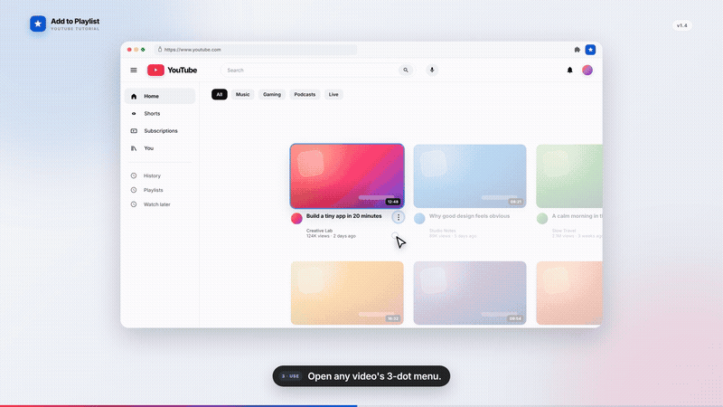

# Add to Playlist

Adds a one-click **Add to &lt;your playlist&gt;** item to the top of every YouTube video's 3-dot menu.

No dialogs, no scrolling through YouTube's native "Save to playlist" flow. Pick a playlist once, then add any video from the home feed, search results, watch page, Shorts or a playlist page.

## Demo



[Watch the full 38-second tutorial (MP4)](video/out/add-to-playlist-tutorial.mp4)

The demo uses a mock YouTube UI and shows the complete flow: install, choose a playlist, open a video's 3-dot menu, and click the starred item. See [`video/README.md`](video/README.md) to rebuild or edit it.

## Quick start

1. **Load the extension.** Open `chrome://extensions` or `brave://extensions`, enable **Developer mode**, click **Load unpacked**, and select this repository folder. See [Install](#install).
2. **Sign in to YouTube** in the same browser profile.
3. **Choose your playlist.** Click the Add to Playlist toolbar icon, enter a playlist name, URL or ID, and click **Save**. See [Configure your playlist](#configure-your-playlist).
4. **Refresh the YouTube tab** so the content script picks up the saved playlist.
5. **Open any video's 3-dot menu** on Home, Search, Watch or Shorts.
6. **Click Add to &lt;your playlist&gt;**.
7. **Confirm the green check** and the **Added to my playlist** toast.

After editing the extension code, repeat the reload steps in [Reload after changes](#reload-after-changes).

## Requirements

- A desktop Chromium-based browser: Chrome, Brave, Edge, etc.
- You must be signed in to YouTube in that browser.
- The target playlist must be one your account can edit.
- Desktop `www.youtube.com`. The mobile site and YouTube Music are not officially supported.

## Install

The extension is loaded as an unpacked extension; there is no build step.

1. Download or clone this repository.

   ```bash
   git clone git@github.com:leonardorey1992/like-watch-later-extension.git
   ```

2. Open the extensions page:
   - Chrome: `chrome://extensions`
   - Brave: `brave://extensions`
   - Edge: `edge://extensions`

3. Turn on **Developer mode**.
4. Click **Load unpacked** and select the repository folder (the folder containing `manifest.json`).
5. Optionally pin **Add to Playlist** to the toolbar.

After loading, open or refresh a YouTube tab so the content script is injected.

## Configure your playlist

1. Click the **Add to Playlist** icon in the toolbar.
2. Enter one of the following:
   - A playlist **name**, e.g. `My Watch Later`
   - A playlist **URL**, e.g. `https://www.youtube.com/playlist?list=PL...`
   - A bare playlist **ID**, e.g. `PL...`
3. Click **Save**.
4. Refresh the YouTube tab.

Using the URL or ID is the most reliable option. Using a name makes the extension look up your playlists and match the name (exact match first, then a partial match), so the name must be close to what YouTube shows.

The menu item reads **Add to &lt;playlist name&gt;** once configured. Before configuration it reads **Add to my playlist**.

## Use

1. Go to any video on YouTube.
2. Open the video's **3-dot menu**. This works on:
   - the home feed
   - search results
   - the watch page
   - channel and playlist pages
   - Shorts and Shorts shelves
3. Click **Add to &lt;your playlist&gt;**.
4. Wait for the green check and the confirmation toast: **Added to my playlist**.
   If the video is already in that playlist, nothing is sent and the toast says **Already in my playlist**.

The video is added directly through YouTube's own internal API, using your existing signed-in session.

### Changing the playlist

Change it in the extension popup, then refresh the YouTube tab. The menu item's label is generated when the menu is built, so an already-open menu can keep the old label until the page is refreshed.

## Troubleshooting

| Problem | What to check |
| --- | --- |
| The custom item does not appear | Reload the extension in the extensions page and refresh the YouTube tab. Make sure you opened the menu of a video, not a comment or channel. |
| The item says "Add to my playlist" | No playlist is configured, or the stored name is empty. Set it in the extension popup. |
| "Set a playlist from the extension icon first" | Configure and save a playlist in the extension popup, then refresh YouTube. |
| "Playlist ... not found" | Use the exact playlist name, or paste the playlist URL/ID instead. |
| An authentication error appears | Sign in to YouTube in the same browser profile, then refresh the tab. |
| "YouTube config not ready" | Refresh the YouTube tab. |
| An invalid playlist error appears | Check the playlist URL/ID. The playlist must be editable by your account. |
| It worked before but stopped after editing the code | Reload the extension and refresh the YouTube tab. Content scripts do not update in already-open tabs. |

If YouTube changes its menu markup, the item may stop being injected. In that case the extension needs an update.

## Permissions and privacy

- **storage** — saves the selected playlist name/ID locally in the browser.
- **youtube.com host permission** — injects the menu item and calls YouTube's internal API as the signed-in user.

There are no analytics, external servers or third-party requests. Everything goes to YouTube.

## How it works

- `content_script.js` detects the 3-dot action-menu button, captures the video id, injects the custom item into the open menu, and shows the toast.
- `page_api.js` runs in YouTube's page world (needed to read `window.ytcfg`) and performs the InnerTube request with YouTube's `SAPISIDHASH` authentication.
- `options.html` / `options.js` store and validate the playlist setting.
- `styles.css` styles the custom menu item (including its star icon) and the toast.

## Development

There is no bundler or build command.

| File | Purpose |
| --- | --- |
| `manifest.json` | Manifest V3 configuration and version |
| `content_script.js` | Menu injection, video id capture, storage, toast |
| `page_api.js` | Page-world InnerTube bridge and authentication |
| `styles.css` | Custom menu item and toast styles |
| `options.html` / `options.js` | Playlist configuration UI |

To test a change:

1. Edit the files.
2. Reload the extension in `chrome://extensions` or `brave://extensions`.
3. Refresh the YouTube tab.
4. Open a video's 3-dot menu and try the item.

### Reload after changes

1. Open `chrome://extensions` or `brave://extensions`.
2. Find **Add to Playlist** and click **Reload**.
3. Refresh every open YouTube tab.
4. Reopen the video's 3-dot menu.

Content scripts do not update in already-open tabs, so the page refresh is required. If the menu item still behaves like the old version, check that the extensions page shows the latest version and reload again.

Bump the `version` in `manifest.json` when publishing a meaningful update.

## License

Source-available under the [PolyForm Noncommercial License 1.0.0](LICENSE).
Free for personal and other noncommercial use. Commercial use requires a
separate license; see [COMMERCIAL.md](COMMERCIAL.md).

Contributions are accepted under the [Contributor License Agreement](CLA.md).
